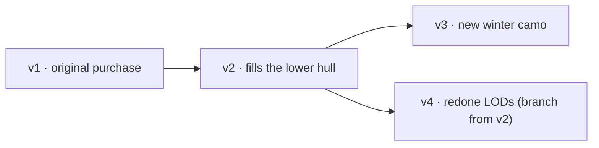

# Hangar — architecture

Hangar is a digital asset manager (DAM) for 3D and game content, written 100% in Rust: it
stores, versions and previews models, textures, audio and the like. The core use case is a
purchased model (e.g. a tank) that needs fixes and improvements over time, keeping its
history and making it easy to compare versions, LODs and texture variants (desert, woodland,
winter...).

```
┌──────────────────────── browser (wasm32) ───────────────────────────┐
│  hangar-web                                                         │
│  ├─ Leptos 0.8 (CSR): library, asset detail, upload, versions       │
│  └─ Bevy 0.19 (WebGL2) via leptos-bevy-canvas: 3D viewer            │
│        orbit camera · LOD · variants · wireframe · grid             │
└───────────────▲─────────────────────────────────────────────────────┘
                │ REST/JSON + blobs (HttpOnly cookie or Bearer)
┌───────────────┴──────────── hangar-server (summer-rs) ──────────────┐
│ WebPlugin (axum) ─ /api/** routes                                    │
│ SaTokenPlugin    ─ sessions/login (memory or Redis)                  │
│ SeaOrmPlugin     ─ Postgres (metadata, versions, file trees)         │
│ OpenDALPlugin    ─ content-addressed blobs (local fs or S3/MinIO)    │
│ JobsPlugin       ─ Postgres queue (SKIP LOCKED) + workers            │
│        └─ hangar-pipeline (spawn_blocking)                           │
│             ufbx · gltf · tobj · headless Blender (fallback)         │
│             LODs (meshoptimizer) · variants · GLB · thumbnails       │
└──────────────────────────────────────────────────────────────────────┘
```

## Crates

| crate | target | role |
|---|---|---|
| `hangar-core` | native + wasm | API DTOs, enums, preview manifest, path utilities |
| `hangar-pipeline` | native | import (FBX/glTF/OBJ/Blender), texture resolution, variant detection, LODs, GLB export, software-rasterized thumbnails, audio metadata |
| `hangar-server` | native | summer-rs REST API, storage, versioning, job queue |
| `hangar-web` | wasm32 | Leptos UI + Bevy viewer |
| `hangar-cli` | native | `hangar push/pull/versions/diff` — sends a folder as a new version (only what changed) |

## Versioning model

Versioning follows the idea of a git commit, but per **asset** and with large binary files:

* **Blob** — immutable content identified by the file's BLAKE3 hash. Stored exactly once at
  `blobs/ab/cd/<hash>` in OpenDAL. Two versions sharing the same 200 MB texture take up
  200 MB, not 400.
* **Version** — immutable snapshot: a `path → blob` tree + `parent_id` + message + author.
  Numbering (`v1`, `v2`, …) is sequential per asset; `parent_id` forms a DAG, so you can
  "branch" (e.g. v4 fixes the hull starting from v2, skipping v3).
* **Head** — the version shown by default for the asset. Every new version becomes head
  (optional).
* **Incremental commit** — `POST /api/assets/{id}/versions` with `parent_id` and
  `inherit=true` starts from the parent's tree and applies `upserts`/`deletes`. To fix the
  mesh you only send the new `.fbx`; textures are inherited without uploading. On the web,
  "Arquivos → Adicionar arquivos" (Files → Add files) opens this flow on top of the selected
  version: a file with the same name as exactly one existing file replaces it in place (e.g.
  a fixed texture in `Texture1/`), a **target folder** places new content (e.g.
  `Animations/`), and a dragged folder keeps its own name (unless it is the asset's root
  folder again).
* **Deduplicated upload** — the client computes each file's BLAKE3 (in the browser, in
  wasm), asks `POST /api/blobs/missing` which ones are missing and only sends those with
  `PUT /api/blobs/{hash}` (streaming; the server re-hashes and validates).
* **Diff** — `GET /api/versions/{id}/diff?against=` compares two trees
  (added / removed / modified / unchanged).



## Processing pipeline

Every new version enqueues a `process_version` job. The worker downloads the relevant files
(models, images, audio) to a temporary directory and calls `hangar_pipeline::process` inside
`spawn_blocking`:

1. **Primary file** — `.glb/.gltf` > `.fbx` > `.obj` > `.blend`. Several model files with
   `_LOD0`, `_LOD1`… suffixes are treated as authored LODs. With more than one FBX, each one
   is inspected: files without geometry don't become the model, and `Model@Clip.fbx` names
   lose preference. The remaining FBX files whose takes move are **animation files**: their
   takes are applied to the model by matching nodes by name (case-insensitive, namespace
   stripped — `mixamorig:Hips` ↔ `Hips`); takes with a generic name ("Take 001",
   "mixamo.com") get the file's name (`Shark@Swim.fbx` → "Swim"). A version with **only
   animations** (no FBX with a mesh) becomes `kind: animation`: see *Reference skeletons*
   below.
2. **Import** — `ufbx` (FBX, normalized to Y-up/meters), `gltf` and `tobj`. glTF materials
   using the legacy `KHR_materials_pbrSpecularGlossiness` model (e.g. Microsoft glTF
   Exporter) are converted to metal/rough: diffuse → base color, roughness = 1 − glossiness
   (the specular-glossiness texture's alpha becomes a roughness map), metallic 0. If the
   model can't be opened, the version falls back to the image preview and `model_error`
   explains why on the stage. Formats not supported natively (e.g. `.blend`) or failures fall
   back to **headless Blender** (`tools/blender/export_glb.py`), when configured.
3. **Texture resolution** — purchased FBX files often point to `C:\Users\artist\...`. The
   pipeline tries, in order: exact path → same file name in any folder → same slot and same
   numbers/tiles (`low1_BaseColor.1001.png` → `Tank_BaseColor.1001.png`) → **manual
   assignment** (`.hangar/materials.json`, see below) → material name
   (`M_Body` ↔ `T_Body_BaseColor.png`) → "siblings" of an already resolved texture (same
   folder and name, only the slot changes: `Tank_BaseColor.1001` → `Tank_Normal.1001`). The
   slot is detected from the suffix (`_D`, `_BaseColor`, `_N`, `_ORM`, `_R`, `_M`, `_AO`,
   `_E`, `_S`...).
   **Specular:** specular level maps (`_S`, `_Spec`, `_Specular`; the FBX specular slot, OBJ
   `map_Ks`, glTF `KHR_materials_specular`) follow the reflectance convention (0.5 = the
   default 4 % F0, like Unreal's *Specular*) and go into the GLB as
   `KHR_materials_specular` (`specularColorTexture` with `specularColorFactor` 2, the
   conversion the extension recommends). Glossiness maps (`_Gloss`) are not specular. Only
   affects non-metallic surfaces.
4. **Texture variants** — two files that differ by a single token that is neither a slot nor
   a number (`Desert/T_Body_D.png` × `Woodland/T_Body_D.png`, or `T_Body_Desert_D` ×
   `T_Body_Woodland_D`) form variants. The first one referenced by the model is the default.
   Manual skins from `.hangar/materials.json` come in with `detected_by: "manual"`.
5. **LODs** — authored (by name) or generated with `meshopt::simplify` (50% / 25% / 10% by
   default), each exported as a **self-contained GLB** with downscaled textures.
   **Animation (FBX and glTF/GLB):** for FBX, when some take actually moves (the empty
   "Take 001" almost every exporter writes is ignored), each take is sampled at the file's
   frame rate with `ufbx::bake_anim`; for glTF, animations are read directly (STEP and
   CUBICSPLINE become linear keys; morph target weights are not exported). The GLB gets the
   node hierarchy (under a single root node), the skins (up to 4 bones per vertex) and the
   clips; keys that interpolation reproduces (0.1 mm / ~0.01°) are dropped. Meshes stay in
   world space through the rest of the pipeline; the GLB writer moves rigid parts into their
   node's space. The manifest lists the clips in `animations` (name, duration, fps, frames
   and, for clips from separate files, `source`).
6. **Thumbnail** — a software rasterizer (z-buffer + Lambert + base texture) renders a PNG
   without needing a GPU on the server.
7. **Textures and audio** — web previews (PNG/JPEG ≤ 2048 px) and a peak envelope for WAV
   waveforms.

The result is a `PreviewManifest` (JSON in `asset_versions.preview`) + generated blobs
(recorded in `renditions`). The viewer only consumes GLBs and web images.

### Manual materials (`.hangar/materials.json`)

When the heuristics aren't enough, the **Materiais** (Materials) tab on the asset page lets
you pick the texture for each slot of each material and create **skins** (alternative sets).
Changes show up immediately in the viewer (preview) and, when saved, become a **new version**
that inherits the previous one and adds only this file — no texture is uploaded again:

```json
{
  "materials": {
    "a1": { "base_color": "Tank_BaseColor.1001.png", "normal": null }
  },
  "skins": [
    { "name": "Desert", "materials": { "a1": { "base_color": "Desert/Tank_BaseColor.1001.png" } } }
  ]
}
```

* `materials`: slot → path forces the texture; `null` forces the slot empty; missing slots
  stay automatic. Material names are compared case-insensitively.
* `skins`: each skin lists only what changes relative to the base.
* The pipeline applies the base to the GLBs and the thumbnail; problems (missing material or
  file) become `warnings`. The CLI sends the file when it exists in the folder, and
  `--mirror` never deletes it.
* `alpha_cutoff`: material → threshold (0–1) for alpha cutout.
* `texture_sets`: ids of assets whose images the model shares (see below).

### Shared texture sets (`texture_sets`)

Packages like "Spark City" ship several models that use the same set of textures. The set
becomes **one asset** (texture kind) and each model **links** it in `.hangar/materials.json`
(`"texture_sets": ["<asset id>"]`), through the **Materiais** tab or with
`hangar push --texture-set <id>` (`tools/import-folders.ps1 -TextureSet <id>`).

* During processing, the worker downloads the images of each set's **head** into the work
  directory under `@<slug>/` and passes them in `ProcessInput::texture_sets`. The version's
  author must be able to see the set (same project, member of its project, or admin);
  otherwise the entry gets an `error` and its name is not revealed.
* The set's images rank **behind** the version's own: model references that don't exist in
  the version are found in the set by file name (`resolved_by: "texture-set"`, siblings such
  as `_Normal` included); material-name heuristics only look at the version's own files.
  Manual assignment uses the `@<slug>/<file>` path.
* The manifest records each set in `texture_sets` (name, prefix, version used, error) and
  lists its images in `textures` with the prefix; the UI downloads the original from the
  set's version (`texture_location`).
* A new head of the set (commit with `set_head` or head change) re-queues the heads whose
  manifest uses it, so every model picks up the new textures.

### Reference skeletons (`.hangar/animation.json`)

Animations exported without a mesh (e.g. Unreal animations, bones only) have nothing to play
on. For them there is a system setting, **Esqueletos** (Skeletons) (`/admin/skeletons`,
admins only): each skeleton has a name, an immutable identifier (`ue5-manny`) and points to a
**regular model asset** (the SK_Mannequin / SKM_Manny FBX with skin and textures, uploaded
like any other asset). The *head* version of that asset always applies.

* The **Animação** (Animation) tab of an animation-only version lists the clips and the
  registered skeletons; ticking skeletons and saving creates a **new version** with
  `{"skeletons": ["ue5-manny", "ue4-mannequin"]}` in `.hangar/animation.json`.
* During processing, the worker resolves each identifier to the head of the skeleton's asset,
  downloads its files into another temporary directory and passes them as
  `ProcessInput::skeletons`. For each skeleton the pipeline imports the model's FBX with the
  version's animation files as external sources (bones matched by name, as with
  `Model@Clip.fbx`), discards the model's own takes and writes a GLB (textures ≤ 1024 px;
  rendition `skeleton_glb`, key = identifier). The manifest gets one entry in `skeletons`
  per identifier, in file order: GLB, clips that move at least one bone,
  `bones_matched`/`bones_total`, the skeleton version used, and `error` when nothing matched
  or the skeleton doesn't exist. The thumbnail is the first skeleton halfway through the
  first clip (pose computed on the CPU, `pose.rs`). `animations` lists every clip of the
  files.
* An animation asset is a **package** ("Rocket Launcher", "Free Fall"): a version with one
  or more animation FBX files, organized in folders however you like; the tab's
  **+ Adicionar animações** (Add animations) button creates a new version of the same
  package, which inherits `.hangar/animation.json`. Clips from different folders are shown
  grouped.
* **Animations uploaded together with a mesh only play on it**: if the version has an FBX
  with geometry *made for those animations* (half or more of an animation file's nodes exist
  in it, `fbx::animates`), `.hangar/animation.json` is ignored (with a warning). Meshes that
  share no bones with the animations — the weapon that comes with a package — are not their
  mesh: they are left out of the preview (warning) and the package plays on the skeletons.
* Constant channels (Unreal writes every bone on every frame) become two keys in the GLB,
  which keeps the GLBs of large packages small.
* Each animation keeps its own copy of the skeleton GLB; a new skeleton model only applies
  after reprocessing. The skeletons page shows how many animations are outdated and has
  **Reprocessar animações** (Reprocess animations) (heads that use the skeleton).

## 3D viewer

Bevy 0.19 runs inside a `<canvas>` managed by Leptos (`leptos-bevy-canvas`). Leptos does all
the HTTP and sends messages to Bevy:

* `LoadModel { bytes }` — GLB of the chosen LOD (through an in-memory asset source); the
  camera is preserved across versions, so switching v1/v2 works as an A/B comparison. In
  animation-only versions, the LOD selector becomes the **skeleton** selector
  (`PreviewManifest::on_skeleton` builds a model manifest with the skeleton's GLB).
* `ApplyVariant { textures, hidden }` — swaps material textures by name and hides textures
  (preview for the Materiais tab).
* `SetWireframe`, `SetAutoRotate`, `SetGrid`, `ResetCamera`.
* `SelectAnimation`, `SetAnimationPaused`, `StepAnimation(±frames)`, `SeekAnimation(s)`,
  `SetAnimationSpeed` — animation bar (selector with previous/next, pause, frame by frame,
  first/last frame and speed; negative speed plays backwards). The GLB's clips go into an
  `AnimationGraph`; Bevy answers with `AnimationTime` for the frame counter.

Controls: left button orbits, right/middle pans, wheel zooms, `F` frames the model.

## Database (Postgres)

```
users(id, username, display_name, password_hash, is_admin, created_at)
projects(id, slug, name, description, created_by, created_at)
project_members(project_id, user_id, role[owner|editor|viewer])
blobs(hash, size, mime, created_at)
assets(id, project_id, slug, name, kind, description, tags jsonb, source jsonb,
       head_version_id, created_by, created_at, updated_at)
asset_versions(id, asset_id, number, parent_id, message, author_id, status, error,
               preview jsonb, file_count, total_size, created_at, processed_at)
version_files(version_id, path, blob_hash, size)          -- the tree
renditions(version_id, kind, key, blob_hash, meta)         -- LOD GLBs, thumbs, previews
jobs(id, kind, payload, status, attempts, max_attempts, run_after, locked_at, last_error)
skeletons(id, slug, name, description, asset_id, created_by, created_at)  -- reference skeletons
api_tokens(id, user_id, name, client, token_hash, created_at, last_used_at)  -- plugin tokens
device_pairings(id, device_code_hash, user_code, client, device_name, detail,
                created_at, expires_at, status, approved_by)  -- pending pairings
```

Migrations are plain SQL embedded in the binary (`crates/hangar-server/migrations`), applied
at boot and tracked in `schema_migrations`.

## Permissions

* `is_admin` (global) — sees everything, creates users, sees the job queue. The first
  registered user becomes admin.
* Per project: `owner` (manages members, deletes assets), `editor` (creates assets and
  versions), `viewer` (read-only).
* Blobs are addressed by a 256-bit hash; downloading requires login and the hash acts as a
  capability (it can't be enumerated). Files by path (`/raw/`) and zips check the project.

## Editor plugins ("Enviar para Unreal")

The Unreal plugin (`tools/unreal/Hangar`) doesn't listen on any port: it keeps an outgoing
connection to the server open (`GET /api/bridge/events`, server-sent events) and the server
relays to it whatever the web page sends. It works the same with Hangar in the cloud, behind
NAT and firewalls, and the page knows which editors are online. (The alternative — the page
talking to `localhost`, as Meshy does — runs into Chrome's Local Network Access prompt and
only works with the browser and the editor on the same machine.)

1. **Pairing** (device flow, like the OAuth device flow): the plugin calls
   `POST /api/devices/pair`, opens `/dispositivos?codigo=XXXX-XXXX` in the browser and polls
   `POST /api/devices/pair/poll` with its secret `device_code`. The logged-in user checks the
   code and approves; the next poll creates an `hgr_…` token (only its BLAKE3 hash is stored)
   and returns it exactly once. The password never goes through the editor.
2. **Tokens**: a layer in front of sa-token's swaps `Authorization: Bearer hgr_…` for a
   sa-token session of the token's owner, kept in memory and rechecked against the database
   every minute (revoking on `/dispositivos` takes effect on every instance within 1 min;
   restarting the server doesn't disconnect plugins).
3. **Sending**: "Enviar para Unreal" (Send to Unreal, on the asset page) →
   `POST /api/bridge/send` → `import` event on the chosen editor's stream. The plugin
   downloads `GET /api/versions/{vid}/bundle` (files by hash, texture-set images included),
   imports, and reports progress on `POST /api/bridge/deliveries/{id}`; the page follows the
   delivery.

Bridge state (connected editors, deliveries) lives in memory per process. With more than one
server instance, a send must reach the instance holding the editor's stream (Postgres
`LISTEN/NOTIFY` in front of `BridgeHub::push`); the load balancer must allow long-lived
responses (the server sends a comment every 15 s).

## REST API

**Authentication:** cookie `hangar_token` (HttpOnly, set on login) or
`Authorization: Bearer <token>` — either a session token or an `hgr_…` access token (plugins;
see "Editor plugins"). Every `/api/**` route requires it except the ones marked
**public** below. Tokens in the query string (`?hangar_token=`) are refused (400): URLs leak
into logs, history and `Referer`.

**Browser protections** (`security.rs`, one layer around everything): state-changing `/api/`
requests (POST/PUT/PATCH/DELETE) must come from the site itself — `Sec-Fetch-Site:
same-origin`, or for older browsers an `Origin` matching `Host`; otherwise 403 (CSRF).
Requests without either header (CLI, editor plugins) pass and authenticate with bearer tokens.
Every response gets `nosniff`, `X-Frame-Options: DENY`, `Referrer-Policy: same-origin`,
COOP/CORP `same-origin` (+ HSTS when `cookie_secure`). API responses carry `CSP: default-src
'none'; sandbox`; the web client gets a strict CSP whose `script-src` allows its inline Trunk
bootstrap by SHA-256, computed when the page is served. Blobs are stored and served only with
the MIME types `paths::mime_for` produces (never HTML/SVG); anything else downloads as an
attachment. Logins are throttled per user name (10 failures / 15 min → 429).

**Authorization:** project-scoped routes check membership through `access::{project, asset,
version}`. Non-members get **404** (existence isn't leaked); an insufficient role gets
**403**. Global admins act as owners everywhere.

**Errors:** HTTP status + plain-text body (summer-web `KnownWebError`). User-facing messages
are in Brazilian Portuguese.

Request/response types live in `crates/hangar-core/src/api.rs`; the pairing and bridge ones
in `crates/hangar-core/src/bridge.rs`.

| area | path prefix | source |
|---|---|---|
| [System](#system) | `/api/health`, `/api/setup` | `auth.rs` |
| [Authentication & users](#authentication--users) | `/api/auth/*`, `/api/users` | `auth.rs` |
| [Projects & members](#projects--members) | `/api/projects/{pid}` | `routes/projects.rs` |
| [Assets](#assets) | `/api/projects/{pid}/assets`, `/api/assets/{aid}` | `routes/assets.rs` |
| [Versions](#versions) | `/api/assets/{aid}/versions`, `/api/versions/{vid}` | `routes/versions.rs` |
| [Files & downloads](#files--downloads) | `/api/versions/{vid}/…` | `routes/versions.rs` |
| [Blobs](#blobs) | `/api/blobs` | `routes/blobs.rs` |
| [Reference skeletons](#reference-skeletons) | `/api/skeletons` | `routes/skeletons.rs` |
| [Access tokens](#access-tokens) | `/api/tokens` | `routes/tokens.rs` |
| [Device pairing](#device-pairing) | `/api/devices/pair` | `routes/tokens.rs` |
| [Editor bridge](#editor-bridge) | `/api/bridge` | `routes/bridge.rs` |
| [Administration](#administration) | `/api/jobs`, `/api/admin` | `routes/jobs.rs` |

### System

| method | path | body → response |
|---|---|---|
| GET | `/api/health` | **public** · `"ok"` |
| GET | `/api/setup` | **public** · `SetupStatus` (`needs_setup` when no user exists yet, `allow_signup`, `blender_available`, server `version`) |

### Authentication & users

| method | path | body → response |
|---|---|---|
| POST | `/api/auth/register` | **public** · `RegisterRequest` → `LoginResponse` (first user, or when signup is open) |
| POST | `/api/auth/login` | **public** · `LoginRequest` → `LoginResponse` + `hangar_token` cookie |
| POST | `/api/auth/logout` | 204 |
| GET | `/api/auth/me` | `UserDto` |
| GET | `/api/users` | admin · `Vec<UserDto>` |
| POST | `/api/users` | admin · `CreateUserRequest` → `UserDto` |

### Projects & members

| method | path | body → response |
|---|---|---|
| GET | `/api/projects` | `Vec<ProjectDto>` (projects the user is a member of; all for admins) |
| POST | `/api/projects` | `CreateProjectRequest` → `ProjectDto` (creator becomes owner) |
| GET | `/api/projects/{pid}` | `ProjectDto` |
| GET | `/api/projects/{pid}/members` | `Vec<MemberDto>` |
| POST | `/api/projects/{pid}/members` | owner · `AddMemberRequest` → `MemberDto` |
| DELETE | `/api/projects/{pid}/members/{uid}` | owner · 204 |

### Assets

| method | path | body → response |
|---|---|---|
| GET | `/api/projects/{pid}/assets?q=&kind=&tag=&page=&size=` | `Page<AssetSummary>` |
| POST | `/api/projects/{pid}/assets` | editor · `CreateAssetRequest` → `AssetDetail` |
| GET | `/api/assets/{aid}` | `AssetDetail` |
| PATCH | `/api/assets/{aid}` | editor · `UpdateAssetRequest` → `AssetDetail` (also changes the head) |
| DELETE | `/api/assets/{aid}` | owner · 204 |

### Versions

| method | path | body → response |
|---|---|---|
| GET | `/api/assets/{aid}/versions` | `Vec<VersionDto>` (newest first) |
| POST | `/api/assets/{aid}/versions` | editor · `CommitVersionRequest` → `VersionDto` (enqueues processing) |
| GET | `/api/versions/{vid}` | `VersionDto` (includes the `PreviewManifest`) |
| GET | `/api/versions/{vid}/diff?against=` | `VersionDiff` (added / removed / modified / unchanged) |
| POST | `/api/versions/{vid}/reprocess` | editor · `VersionDto` (re-queues the processing job) |

### Files & downloads

| method | path | body → response |
|---|---|---|
| GET | `/api/versions/{vid}/files` | `Vec<FileEntry>` (the version's tree) |
| GET | `/api/versions/{vid}/raw/{*path}` | file bytes (`?download=1` forces an attachment) |
| GET | `/api/versions/{vid}/archive` | zip of the tree (+ texture-set images in use, under `@slug/`) |
| GET | `/api/versions/{vid}/bundle` | `VersionBundle`: version + files to download (same as the zip), by hash |

### Blobs

| method | path | body → response |
|---|---|---|
| POST | `/api/blobs/missing` | `MissingBlobsRequest` → `MissingBlobsResponse` (hashes the server doesn't have yet) |
| PUT | `/api/blobs/{hash}` | raw body (streamed, re-hashed, rejected on mismatch) → `BlobUploaded` |
| GET | `/api/blobs/{hash}` | bytes (immutable cache; the hash acts as a capability) |

### Reference skeletons

| method | path | body → response |
|---|---|---|
| GET | `/api/skeletons` | `Vec<SkeletonDto>` (any logged-in user) |
| POST | `/api/skeletons` | admin · `CreateSkeletonRequest` → `SkeletonDto` |
| PATCH | `/api/skeletons/{id}` | admin · `UpdateSkeletonRequest` → `SkeletonDto` |
| DELETE | `/api/skeletons/{id}` | admin · 204 |
| POST | `/api/skeletons/{id}/reprocess` | admin · re-queues the heads that use the skeleton → `ReprocessQueued` |

### Access tokens

| method | path | body → response |
|---|---|---|
| GET | `/api/tokens` | `Vec<ApiTokenDto>` of the current user |
| DELETE | `/api/tokens/{id}` | revokes a token → 204 |
| DELETE | `/api/tokens/current` | the plugin revokes its own token (on disconnect) → 204 |

### Device pairing

Device flow used by editor plugins; see "Editor plugins".

| method | path | body → response |
|---|---|---|
| POST | `/api/devices/pair` | **public** · `PairStartRequest` → `PairStartResponse` (device code + user code) |
| POST | `/api/devices/pair/poll` | **public** · `PairPollRequest` → `PairPollResponse` (the token, exactly once) |
| GET | `/api/devices/pair/{code}` | `PairInfo` of the pending pairing (shown on `/dispositivos`) |
| POST | `/api/devices/pair/{code}` | `PairDecision` (approve / deny) → 204 |

### Editor bridge

| method | path | body → response |
|---|---|---|
| GET | `/api/bridge/events?app=&name=&detail=` | the editor's SSE stream: `hello` (`BridgeHello`), `import` (`BridgeImport`); comment every 15 s |
| GET | `/api/bridge/clients` | `Vec<BridgeClientDto>`: the user's editors connected right now |
| POST | `/api/bridge/send` | `BridgeSendRequest` → `DeliveryDto` |
| GET | `/api/bridge/deliveries/{id}` | `DeliveryDto` (the page follows progress) |
| POST | `/api/bridge/deliveries/{id}` | the editor reports progress (`DeliveryUpdate`) → `DeliveryDto` |

### Administration

| method | path | body → response |
|---|---|---|
| GET | `/api/jobs?status=` | admin · `Vec<JobDto>` |
| POST | `/api/admin/gc?grace_hours=24` | admin · deletes unreferenced blobs (grace period protects in-flight uploads) |
