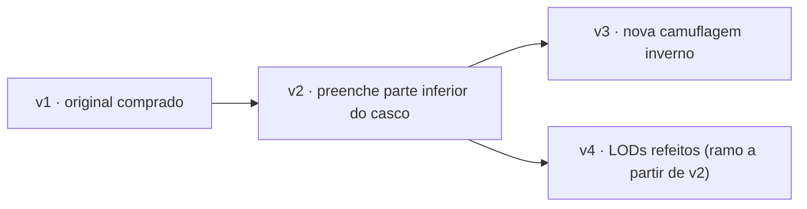

# Hangar — arquitetura

Hangar é um gerenciador de ativos digitais (DAM) para 3D e games, escrito 100% em Rust:
armazena, versiona e visualiza modelos, texturas, áudio e afins. O caso de uso central é
o de um modelo comprado (ex.: um tanque) que precisa de correções e melhorias ao longo do
tempo, mantendo o histórico e permitindo comparar versões, LODs e variantes de textura
(deserto, floresta, inverno...).

```
┌──────────────────────── navegador (wasm32) ────────────────────────┐
│  hangar-web                                                         │
│  ├─ Leptos 0.8 (CSR): biblioteca, detalhe do asset, upload, versões │
│  └─ Bevy 0.19 (WebGL2) via leptos-bevy-canvas: viewer 3D             │
│        câmera orbital · LOD · variantes · wireframe · grid           │
└───────────────▲─────────────────────────────────────────────────────┘
                │ REST/JSON + blobs (cookie HttpOnly ou Bearer)
┌───────────────┴──────────── hangar-server (summer-rs) ──────────────┐
│ WebPlugin (axum) ─ rotas /api/**                                     │
│ SaTokenPlugin    ─ sessões/login (memória ou Redis)                  │
│ SeaOrmPlugin     ─ Postgres (metadados, versões, árvore de arquivos) │
│ OpenDALPlugin    ─ blobs content-addressed (fs local ou S3/MinIO)    │
│ JobsPlugin       ─ fila em Postgres (SKIP LOCKED) + workers          │
│        └─ hangar-pipeline (spawn_blocking)                           │
│             ufbx · gltf · tobj · Blender headless (fallback)         │
│             LODs (meshoptimizer) · variantes · GLB · thumbnails      │
└──────────────────────────────────────────────────────────────────────┘
```

## Crates

| crate | alvo | papel |
|---|---|---|
| `hangar-core` | native + wasm | DTOs da API, enums, manifesto de preview, utilitários de caminho |
| `hangar-pipeline` | native | importação (FBX/glTF/OBJ/Blender), resolução de texturas, detecção de variantes, LODs, exportação GLB, thumbnail por rasterização em software, metadados de áudio |
| `hangar-server` | native | API REST em summer-rs, storage, versionamento, fila de jobs |
| `hangar-web` | wasm32 | UI Leptos + viewer Bevy |
| `hangar-cli` | native | `hangar push/pull/versions/diff` — envia uma pasta como nova versão (só o que mudou) |

## Modelo de versionamento

O versionamento segue a ideia de um commit do git, mas por **asset** e com arquivos
binários grandes:

* **Blob** — conteúdo imutável identificado pelo BLAKE3 do arquivo. Guardado uma única vez
  em `blobs/ab/cd/<hash>` no OpenDAL. Duas versões que compartilham a mesma textura de
  200 MB ocupam 200 MB, não 400.
* **Versão** — snapshot imutável: uma árvore `caminho → blob` + `parent_id` + mensagem +
  autor. A numeração (`v1`, `v2`, …) é sequencial por asset; o `parent_id` forma um DAG,
  então dá para “ramificar” (ex.: v4 corrige o casco a partir de v2, ignorando a v3).
* **Head** — a versão exibida por padrão no asset. Toda versão nova vira head (opcional).
* **Commit incremental** — `POST /api/assets/{id}/versions` com `parent_id` e
  `inherit=true` parte da árvore do pai e aplica `upserts`/`deletes`. Para corrigir o mesh
  basta enviar o novo `.fbx`; as texturas são herdadas sem upload. Na web, "Arquivos →
  Adicionar arquivos" abre esse fluxo sobre a versão selecionada: um arquivo com o mesmo nome
  de exatamente um arquivo existente o substitui no lugar (ex.: textura corrigida em
  `Texture1/`), uma **pasta de destino** posiciona conteúdo novo (ex.: `Animations/`) e uma
  pasta arrastada mantém o próprio nome (salvo quando é a pasta raiz do asset de novo).
* **Upload deduplicado** — o cliente calcula o BLAKE3 de cada arquivo (no browser, em
  wasm), pergunta `POST /api/blobs/missing` quais faltam e só envia esses com
  `PUT /api/blobs/{hash}` (streaming; o servidor recalcula e valida o hash).
* **Diff** — `GET /api/versions/{id}/diff?against=` compara duas árvores
  (adicionados / removidos / modificados / inalterados).



## Pipeline de processamento

Cada versão nova enfileira um job `process_version`. O worker baixa os arquivos
relevantes (modelos, imagens, áudio) para um diretório temporário e chama
`hangar_pipeline::process` em `spawn_blocking`:

1. **Arquivo primário** — `.glb/.gltf` > `.fbx` > `.obj` > `.blend`. Vários arquivos de
   modelo com sufixo `_LOD0`, `_LOD1`… são tratados como LODs autorais. Com mais de um FBX,
   cada um é inspecionado: arquivos sem geometria não viram modelo, e nomes `Modelo@Clipe.fbx`
   perdem a preferência. Os demais FBX cujos takes se movem são **arquivos de animação**: os
   takes são aplicados ao modelo casando nós pelo nome (sem maiúsculas e sem namespace —
   `mixamorig:Hips` ↔ `Hips`); takes com nome genérico ("Take 001", "mixamo.com") recebem o
   nome do arquivo (`Shark@Swim.fbx` → "Swim"). Uma versão **só com animações** (nenhum
   FBX com malha) vira `kind: animation`: ver *Esqueletos de referência* abaixo.
2. **Importação** — `ufbx` (FBX, normaliza para Y-up/metros), `gltf` e `tobj`. Materiais
   glTF no modelo antigo `KHR_materials_pbrSpecularGlossiness` (ex.: Microsoft glTF
   Exporter) viram metal/rough: difusa → base color, rugosidade = 1 − glossiness (o alfa da
   textura specular-glossiness vira um mapa de rugosidade), metálico 0. Se o modelo não abre,
   a versão cai para a pré-visualização das imagens e `model_error` explica o motivo no palco.
   Formatos não suportados nativamente (ex.: `.blend`) ou falhas caem no **fallback do
   Blender headless** (`tools/blender/export_glb.py`), quando configurado.
3. **Resolução de texturas** — FBX comprados costumam apontar para `C:\Users\artista\...`.
   O pipeline tenta, em ordem: caminho exato → mesmo nome de arquivo em qualquer pasta →
   mesmo slot e mesmos números/tiles (`low1_BaseColor.1001.png` → `Tank_BaseColor.1001.png`)
   → **atribuição manual** (`.hangar/materials.json`, ver abaixo) → nome do material
   (`M_Body` ↔ `T_Body_BaseColor.png`) → "irmãos" de uma textura já resolvida (mesma pasta e
   nome, só o slot muda: `Tank_BaseColor.1001` → `Tank_Normal.1001`). O slot é detectado
   pelo sufixo (`_D`, `_BaseColor`, `_N`, `_ORM`, `_R`, `_M`, `_AO`, `_E`, `_S`...).
   **Specular:** mapas de nível especular (`_S`, `_Spec`, `_Specular`; slot specular do FBX,
   `map_Ks` do OBJ, `KHR_materials_specular` do glTF) seguem a convenção de refletância
   (0,5 = os 4 % padrão de F0, como o *Specular* da Unreal) e vão para o GLB como
   `KHR_materials_specular` (`specularColorTexture` com `specularColorFactor` 2, a conversão
   indicada pela extensão). Mapas de glossiness (`_Gloss`) não são specular. Só afeta
   superfícies não metálicas.
4. **Variantes de textura** — dois arquivos que diferem em um único token que não é um slot
   nem um número (`Desert/T_Body_D.png` × `Woodland/T_Body_D.png`, ou `T_Body_Desert_D` ×
   `T_Body_Woodland_D`) formam variantes. A primeira referenciada pelo modelo é a padrão.
   Skins manuais de `.hangar/materials.json` entram com `detected_by: "manual"`.
5. **LODs** — autorais (por nome) ou gerados com `meshopt::simplify` (50% / 25% / 10% por
   padrão), cada um exportado como **GLB autocontido** com texturas reduzidas.
   **Animação (FBX e glTF/GLB):** no FBX, quando algum take realmente se move (o "Take 001"
   vazio que quase todo exportador grava é ignorado), cada take é amostrado na taxa de
   quadros do arquivo com `ufbx::bake_anim`; no glTF as animações são lidas direto (STEP e
   CUBICSPLINE viram chaves lineares; pesos de morph targets não são exportados). O GLB
   ganha a hierarquia de nós (sob um nó raiz único), as skins (até 4 ossos por vértice) e os
   clipes; chaves que a interpolação reproduz (0,1 mm / ~0,01°) são descartadas. As malhas continuam em espaço de mundo no resto do
   pipeline; o writer do GLB leva as partes rígidas para o espaço do seu nó. O manifesto
   lista os clipes em `animations` (nome, duração, fps, quadros e, para clipes de arquivos
   separados, `source`).
6. **Thumbnail** — rasterizador em software (z-buffer + Lambert + textura base) gera um
   PNG sem precisar de GPU no servidor.
7. **Texturas e áudio** — previews web (PNG/JPEG ≤ 2048 px) e envelope de picos para
   waveform de WAV.

O resultado é um `PreviewManifest` (JSON em `asset_versions.preview`) + blobs gerados
(registrados em `renditions`). O viewer só consome GLB e imagens web.

### Materiais manuais (`.hangar/materials.json`)

Quando a heurística não basta, a aba **Materiais** da página do asset permite escolher a
textura de cada slot de cada material e criar **skins** (conjuntos alternativos). As
alterações aparecem na hora no viewer (pré-visualização) e, ao salvar, viram uma **nova
versão** que herda a anterior e acrescenta só este arquivo — nenhuma textura é reenviada:

```json
{
  "materials": {
    "a1": { "base_color": "Tank_BaseColor.1001.png", "normal": null }
  },
  "skins": [
    { "name": "Deserto", "materials": { "a1": { "base_color": "Desert/Tank_BaseColor.1001.png" } } }
  ]
}
```

* `materials`: slot → caminho força a textura; `null` força o slot vazio; slots ausentes
  continuam automáticos. Nomes de material são comparados sem diferenciar maiúsculas.
* `skins`: cada skin lista só o que muda em relação à base.
* O pipeline aplica a base nos GLBs e na thumbnail; problemas (material ou arquivo
  inexistente) viram `warnings`. A CLI envia o arquivo quando ele existe na pasta, e
  `--mirror` nunca o apaga.

### Esqueletos de referência (`.hangar/animation.json`)

Animações exportadas sem malha (ex.: animações do Unreal, só os ossos) não têm onde tocar.
Para elas existe uma configuração do sistema, **Esqueletos** (`/admin/skeletons`, só
admins): cada esqueleto tem nome, um identificador imutável (`ue5-manny`) e aponta para um
**asset de modelo comum** (o FBX do SK_Mannequin / SKM_Manny com skin e texturas, enviado
como qualquer asset). Sempre vale a versão *head* desse asset.

* A aba **Animação** de uma versão só com animações lista os clipes e os esqueletos
  cadastrados; marcar esqueletos e salvar cria uma **nova versão** com
  `{"skeletons": ["ue5-manny", "ue4-mannequin"]}` em `.hangar/animation.json`.
* No processamento, o worker resolve cada identificador para a head do asset do esqueleto,
  baixa os arquivos dela para outro diretório temporário e passa como
  `ProcessInput::skeletons`. Para cada esqueleto o pipeline importa o FBX do modelo com os
  arquivos de animação da versão como fontes externas (ossos casados pelo nome, como em
  `Modelo@Clipe.fbx`), descarta os takes do próprio modelo e grava um GLB (texturas ≤ 1024
  px; rendition `skeleton_glb`, chave = identificador). O manifesto ganha uma entrada em
  `skeletons` por identificador, na ordem do arquivo: GLB, clipes que movem algum osso,
  `bones_matched`/`bones_total`, versão do esqueleto usada e `error` quando nada casou ou o
  esqueleto não existe. A thumbnail é o primeiro esqueleto no meio do primeiro clipe
  (pose calculada na CPU, `pose.rs`). `animations` lista todos os clipes dos arquivos.
* Um asset de animação é um **pacote** ("Rocket Launcher", "Free Fall"): uma versão com
  um ou vários FBX de animação, organizados em pastas à vontade; o botão **+ Adicionar
  animações** da aba cria uma versão nova do mesmo pacote, que herda o
  `.hangar/animation.json`. Clipes de pastas diferentes aparecem agrupados.
* **Animações enviadas junto com uma malha tocam só nela**: se a versão tem um FBX com
  geometria *feito para essas animações* (metade ou mais dos nós de um arquivo de animação
  existem nele, `fbx::animates`), `.hangar/animation.json` é ignorado (com aviso). Malhas
  que não compartilham ossos com as animações — a arma que acompanha um pacote — não são a
  malha delas: ficam fora da pré-visualização (aviso) e o pacote toca nos esqueletos.
* Canais constantes (o Unreal grava todos os ossos em todo quadro) viram duas chaves no GLB,
  o que mantém pequenos os GLBs de pacotes grandes.
* Cada animação guarda a própria cópia do GLB do esqueleto; um modelo novo do esqueleto só
  vale depois de reprocessar. A página de esqueletos mostra quantas animações estão
  desatualizadas e tem **Reprocessar animações** (heads que usam o esqueleto).

## Viewer 3D

Bevy 0.19 roda dentro de um `<canvas>` gerenciado pelo Leptos (`leptos-bevy-canvas`).
O Leptos faz todo o HTTP e envia mensagens ao Bevy:

* `LoadModel { bytes }` — GLB do LOD escolhido (via fonte de assets em memória);
  a câmera é preservada entre versões, então alternar v1/v2 funciona como comparação A/B.
  Em versões só com animações, o seletor de LOD vira o seletor de **esqueleto**
  (`PreviewManifest::on_skeleton` monta um manifesto de modelo com o GLB do esqueleto).
* `ApplyVariant { textures, hidden }` — troca as texturas dos materiais por nome e oculta
  texturas (pré-visualização da aba Materiais).
* `SetWireframe`, `SetAutoRotate`, `SetGrid`, `ResetCamera`.
* `SelectAnimation`, `SetAnimationPaused`, `StepAnimation(±quadros)`, `SetAnimationSpeed`
  — barra de animação (seletor com anterior/próxima, pausa, quadro a quadro e velocidade,
  negativa toca ao contrário). Os clipes do GLB vão para um `AnimationGraph`; o Bevy
  responde com `AnimationTime` para o contador de quadros.

Controles: botão esquerdo orbita, direito/meio faz pan, roda dá zoom, `F` enquadra.

## Banco de dados (Postgres)

```
users(id, username, display_name, password_hash, is_admin, created_at)
projects(id, slug, name, description, created_by, created_at)
project_members(project_id, user_id, role[owner|editor|viewer])
blobs(hash, size, mime, created_at)
assets(id, project_id, slug, name, kind, description, tags jsonb, source jsonb,
       head_version_id, created_by, created_at, updated_at)
asset_versions(id, asset_id, number, parent_id, message, author_id, status, error,
               preview jsonb, file_count, total_size, created_at, processed_at)
version_files(version_id, path, blob_hash, size)          -- a árvore
renditions(version_id, kind, key, blob_hash, meta)         -- LOD GLBs, thumbs, previews
jobs(id, kind, payload, status, attempts, max_attempts, run_after, locked_at, last_error)
skeletons(id, slug, name, description, asset_id, created_by, created_at)  -- esqueletos de referência
```

As migrations são SQL puro embutido no binário (`crates/hangar-server/migrations`),
aplicadas no boot com controle em `schema_migrations`.

## Permissões

* `is_admin` (global) — vê tudo, cria usuários, vê a fila de jobs. O primeiro usuário
  registrado vira admin.
* Por projeto: `owner` (gerencia membros, apaga assets), `editor` (cria assets e versões),
  `viewer` (somente leitura).
* Blobs são endereçados por hash de 256 bits; o download exige login e o hash funciona como
  capability (não é enumerável). Arquivos por caminho (`/raw/`) e zip verificam o projeto.

## API REST

Autenticação: cookie `hangar_token` (HttpOnly, definido no login) ou
`Authorization: Bearer <token>`.

| método | rota | corpo → resposta |
|---|---|---|
| GET | `/api/health` | `"ok"` |
| GET | `/api/setup` | `SetupStatus` (público) |
| POST | `/api/auth/register` | `RegisterRequest` → `LoginResponse` (primeiro usuário ou signup aberto) |
| POST | `/api/auth/login` | `LoginRequest` → `LoginResponse` + cookie |
| POST | `/api/auth/logout` | 204 |
| GET | `/api/auth/me` | `UserDto` |
| GET/POST | `/api/users` | admin: lista / `CreateUserRequest` |
| GET/POST | `/api/projects` | `Vec<ProjectDto>` / `CreateProjectRequest` → `ProjectDto` |
| GET | `/api/projects/{pid}` | `ProjectDto` |
| GET/POST | `/api/projects/{pid}/members` | `Vec<MemberDto>` / `AddMemberRequest` |
| DELETE | `/api/projects/{pid}/members/{uid}` | 204 |
| GET | `/api/projects/{pid}/assets?q=&kind=&tag=&page=&size=` | `Page<AssetSummary>` |
| POST | `/api/projects/{pid}/assets` | `CreateAssetRequest` → `AssetDetail` |
| GET/PATCH/DELETE | `/api/assets/{aid}` | `AssetDetail` / `UpdateAssetRequest` |
| GET | `/api/assets/{aid}/versions` | `Vec<VersionDto>` (mais nova primeiro) |
| POST | `/api/assets/{aid}/versions` | `CommitVersionRequest` → `VersionDto` |
| GET | `/api/versions/{vid}` | `VersionDto` |
| GET | `/api/versions/{vid}/files` | `Vec<FileEntry>` |
| GET | `/api/versions/{vid}/diff?against=` | `VersionDiff` |
| POST | `/api/versions/{vid}/reprocess` | `VersionDto` |
| GET | `/api/versions/{vid}/raw/{*path}` | bytes do arquivo (`?download=1` força anexo) |
| GET | `/api/versions/{vid}/archive` | zip da árvore |
| POST | `/api/blobs/missing` | `MissingBlobsRequest` → `MissingBlobsResponse` |
| PUT | `/api/blobs/{hash}` | corpo cru → `BlobUploaded` |
| GET | `/api/blobs/{hash}` | bytes (cache imutável) |
| GET | `/api/skeletons` | `Vec<SkeletonDto>` (qualquer usuário logado) |
| POST | `/api/skeletons` | admin: `CreateSkeletonRequest` → `SkeletonDto` |
| PATCH/DELETE | `/api/skeletons/{id}` | admin: `UpdateSkeletonRequest` → `SkeletonDto` / 204 |
| POST | `/api/skeletons/{id}/reprocess` | admin: reprocessa as heads que usam o esqueleto → `ReprocessQueued` |
| GET | `/api/jobs?status=` | admin: `Vec<JobDto>` |
| POST | `/api/admin/gc?grace_hours=24` | admin: apaga blobs não referenciados |

Erros: status HTTP + corpo texto (`KnownWebError` do summer-web).
